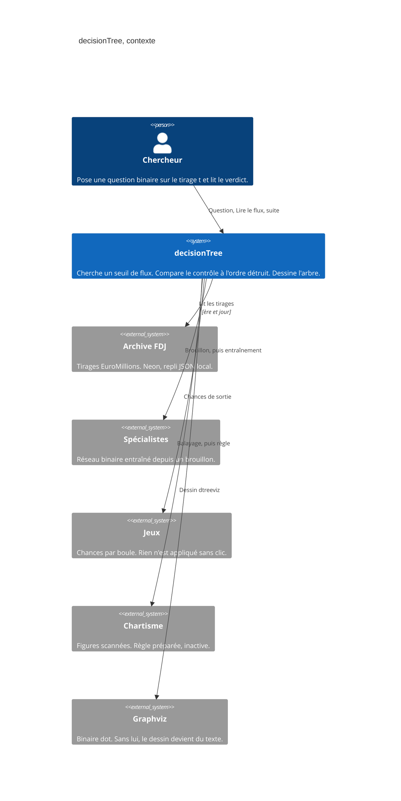

# decisionTree — contexte

- Module : `/brain/decision-tree`
- Niveau : C4 contexte
- Révision : 1
- Code : `src/app/brain/decision-tree/page.tsx`, `synchro/decision_tree/reading.py`

Le chercheur ne parle qu’à decisionTree. L’archive alimente le tableau. Les spécialistes, Jeux et Chartisme ne reçoivent quelque chose qu’après un clic de suite. Graphviz ne sert qu’au dessin.

## Journal

| Révision | Changement |
| --- | --- |
| 1 | Contexte aligné sur la page, l’archive, les suites et le dessin. |
