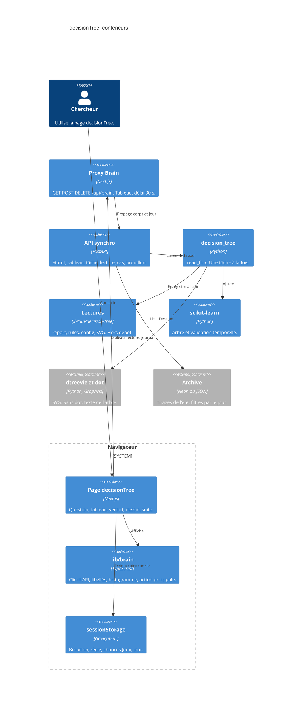

# decisionTree — conteneurs

- Module : `/brain/decision-tree`
- Niveau : C4 conteneurs
- Révision : 1
- Code : `src/lib/brain/decision-tree.ts`, `src/app/api/brain/[...path]/route.ts`, `synchro/app.py`, `synchro/decision_tree/`

Le navigateur ne choisit pas la profondeur finale. Il envoie un plafond, un critère éventuel, N, la coupe et les fenêtres. Python cherche, note, et ne sauve le dossier qu’une fois le rapport complet. Une annulation laisse le dossier vide.

## Journal

| Révision | Changement |
| --- | --- |
| 1 | Conteneurs du navigateur, du proxy, du paquet et des fichiers. |
