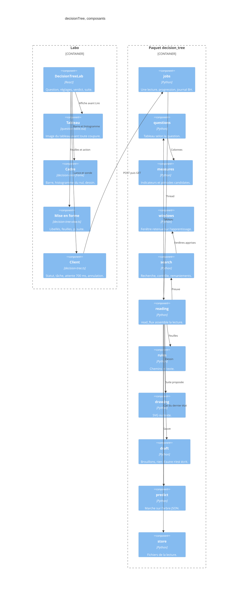

# decisionTree — composants

- Module : `/brain/decision-tree`
- Niveau : C4 composants
- Révision : 1
- Code : `src/components/brain/decision-tree-lab.tsx`, `synchro/decision_tree/`

Le tableau de l’écran appelle `question_picture`. Il ne lance pas `read_flux`. La lecture part seulement de **Lire le flux**.

## Journal

| Révision | Changement |
| --- | --- |
| 1 | Composants du labo et du paquet, dans l’ordre d’appel de `read_flux`. |
