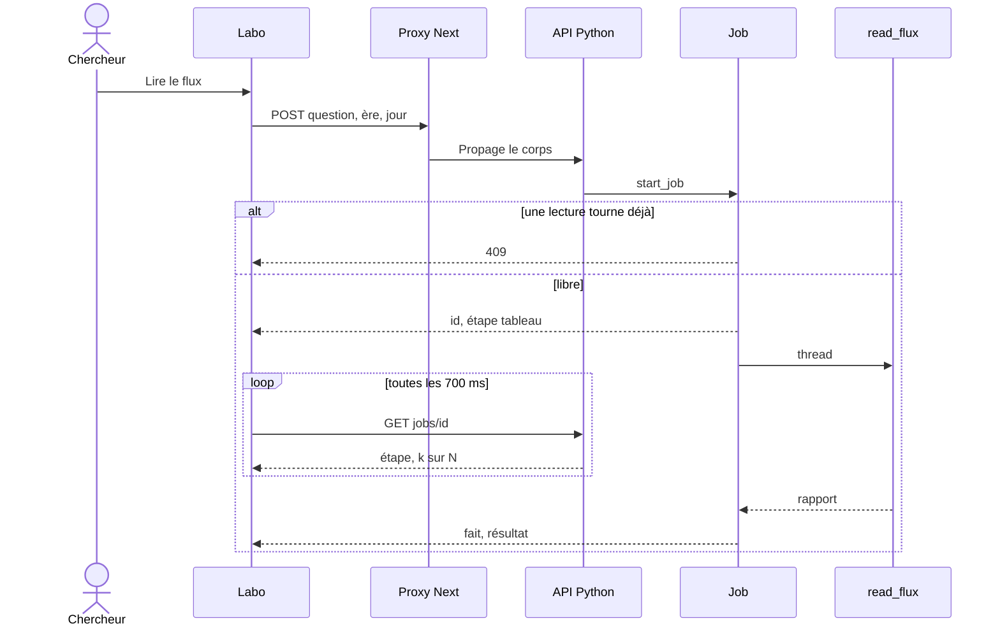
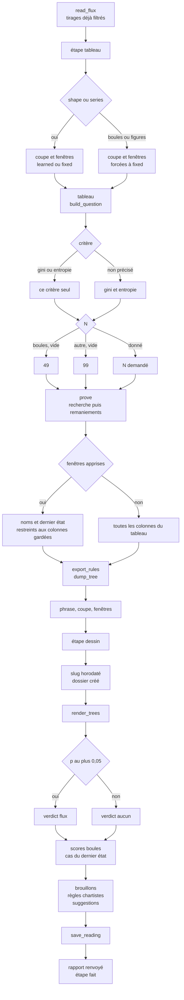

# Lecture — flux

- Module : `/brain/decision-tree`
- Niveau : flux
- Révision : 1
- Code : `synchro/decision_tree/reading.py`, `jobs.py`, `src/lib/brain/decision-tree.ts`

`read_flux` est la fonction. Elle ne s’arrête pas à l’arbre ajusté : le rapport n’existe qu’après le nul, le dessin et l’enregistrement. Le détail du tableau est dans [Tableau](05-tableau-flux.md). Le détail d’un ajustement est dans [Recherche](06-recherche-flux.md). La sortie est dans [Sortie](07-sortie-flux.md).

Échap ou **Annuler** envoie DELETE. Le thread lit le drapeau à chaque étape. Le statut devient annulé. Rien n’est écrit sous `.brain/decision-tree/`.

Les quatre étapes réelles de la barre sont `tableau`, `recherche`, `remaniements` (k/N), `dessin`. `recherche` et `remaniements` sont émises par `prove`. Le contrôle ne choisit ni la fenêtre, ni la coupe, ni la profondeur, ni le critère.

Graine 0 par défaut. Le nul tire avec la graine plus un. L’ère et le jour sont recopiés sur le rapport. Ils ne réentrent pas dans l’arbre.

## Journal

| Révision | Changement |
| --- | --- |
| 1 | Flux de `read_flux`, de la tâche au rapport sauvé. |
