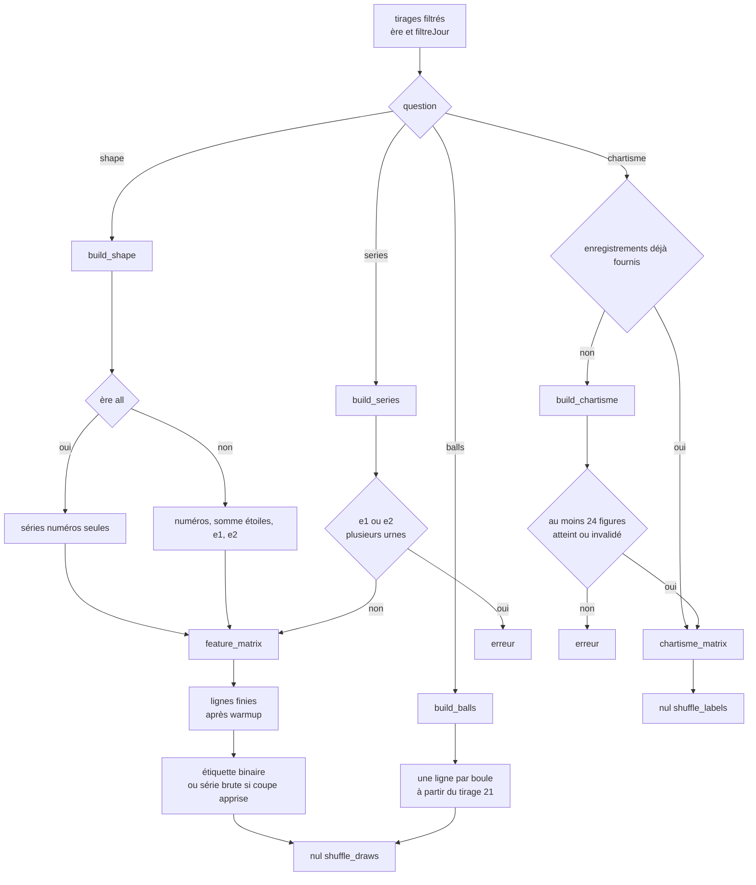

# Tableau — flux

- Module : `/brain/decision-tree`
- Niveau : flux
- Révision : 1
- Code : `synchro/decision_tree/questions.py`, `measures.py`

Une ligne est l’état juste avant le tirage t. L’étiquette est sur t+1. Le mot « retard » ne désigne que le retard d’une boule. Un pas ou un lag s’appelle « dernière ».

## Questions

| Question | Colonnes | Étiquette | Poids | Nul |
| --- | --- | --- | --- | --- |
| `shape` | Catalogue sur somme, étendue, parité, n1 à n5, g1 à g4, et les étoiles si l’ère n’est pas `all` | Somme haute, parité, ou n1 bas | `balanced` si la coupe est apprise | Mélange des tirages, tableau reconstruit |
| `series` | Même catalogue sur cette série, sans le pas | La série est haute, ou la parité | `balanced` si la coupe est apprise | Mélange des tirages, tableau reconstruit |
| `balls` | Retard, sorties 20, sorties 50, dernière, RSI 14, z20 du retard | La boule sort | `balanced` | Mélange des tirages, tableau reconstruit |
| `chartisme` | Confiance, activité, longueur, direction hausse, mardi, courbe, figure | Objectif atteint | `balanced` | Étiquettes mélangées, même matrice |

Le catalogue par défaut du flux est tout `MEASURE_IDS`. Une série retire `step`. Un indicateur retiré par l’écran sort des colonnes. Les figures lisent par défaut somme, étendue, parité et n1, échelle 60, confiance minimale 0,35, horizon 40. Seuls les objectifs atteints ou les figures invalidées entrent.

L’écran demande d’abord `POST /api/brain/decision-tree/tableau`. `question_picture` regroupe les lignes, pose la frontière apprentissage / contrôle, et montre les huit dernières en valeurs exactes. Cette image ne cherche pas l’arbre.

## Coupe figée, avant la recherche

Quand la coupe est `fixed`, l’étiquette est déjà binaire dans le tableau. Parité : au moins 3. Les autres formes : médiane de l’apprentissage, sens ≥, sauf n1 bas en sens ≤. Le seuil du spécialiste binaire est ce seuil-là. La coupe apprise laisse la série brute et choisit plus tard, dans [Recherche](06-recherche-flux.md).

## Journal

| Révision | Changement |
| --- | --- |
| 1 | Tableau des quatre questions, étoiles, urnes et nuls. |
