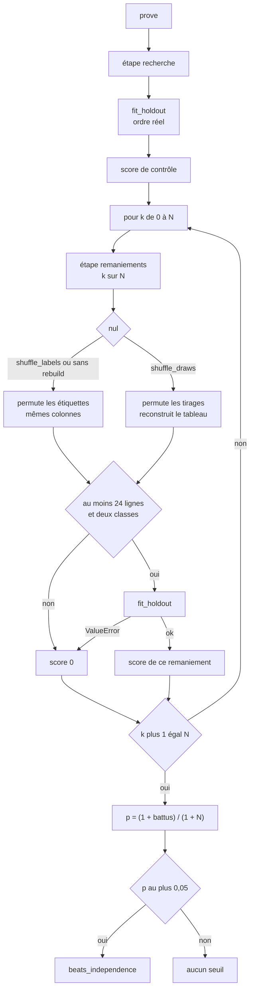
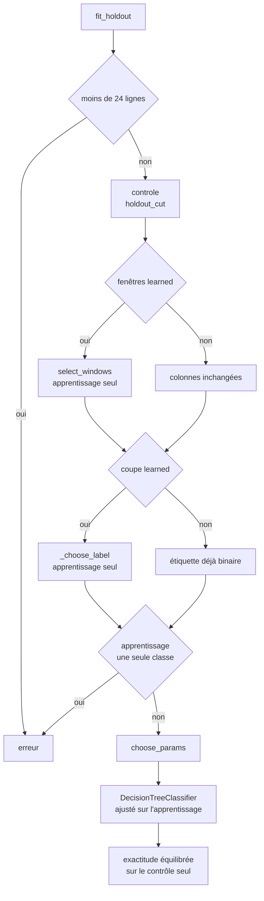

# Recherche — flux

- Module : `/brain/decision-tree`
- Niveau : flux
- Révision : 1
- Code : `synchro/decision_tree/search.py`, `windows.py`

`prove` ajuste une fois sur l’ordre réel, puis rejoue `fit_holdout` à chaque remaniement. Le score qui compte est l’exactitude équilibrée du contrôle : moyenne des rappels des classes présentes.

Un remaniement « au moins aussi bon » a un score supérieur ou égal au score réel, à 1e-12 près. p n’est pas comparé à 0,50 ni à 5/50.

## Découpe

| Lignes | Apprentissage | Contrôle |
| --- | --- | --- |
| moins de 40 | 70 %, au moins 1 | le reste |
| 40 ou plus | tout sauf les 100 derniers, au moins 20 | 100 derniers |

## Fenêtres

Une fenêtre est notée par une souche : réduction relative d’erreur quadratique sur la série brute, en validation temporelle de l’apprentissage. Trois plis à partir de 40 lignes, deux à partir de 16, sinon la note est nulle.

On ne quitte la période habituelle que si une autre fait mieux d’au moins un écart-type des plis. Un score au plus 0 ne bat pas la moyenne : la période habituelle reste. Z-score, Bollinger et CCI ne descendent pas sous 8. Le plafond est 34, ou le nombre de tirages divisé par 15 si c’est plus court. Le mode `fixed` garde RSI 14, z-score 20, pente 10, et les autres périodes du catalogue.

Le retard affiché d’une fenêtre changée vaut (période − 1) / 2 tirages.

## Coupe de l’étiquette

Parité : 2, 3 ou 4. Les autres formes : quantiles 30, 40, 50, 60 et 70 % de l’apprentissage, valeurs trop proches fusionnées. Un candidat sans deux classes est écarté. Chaque candidat relance `choose_params`. On garde le meilleur score de validation, et à égalité le seuil le plus proche de la médiane. Le contrôle ne vote pas. Chaque remaniement rejoue ce choix.

## Paramètres de l’arbre

Profondeurs de 2 jusqu’au plafond demandé, lui-même borné à 4. Critères : celui demandé, ou Gini et entropie. Le plancher de feuille est 2 % de l’apprentissage et au moins 20 dès 200 lignes. En dessous, 5 %, au moins 2.

La validation temporelle est la même que pour les fenêtres. Le rang est le score moins 0,01 par cran de profondeur au-delà de 2 : à score égal, l’arbre le moins profond gagne. L’arbre final est réajusté sur tout l’apprentissage avec ces paramètres. Le poids `balanced` suit la question : boules, figures, et flux dont la coupe est apprise.

## Journal

| Révision | Changement |
| --- | --- |
| 1 | Preuve, découpe, fenêtres, coupe et choix des paramètres. |
