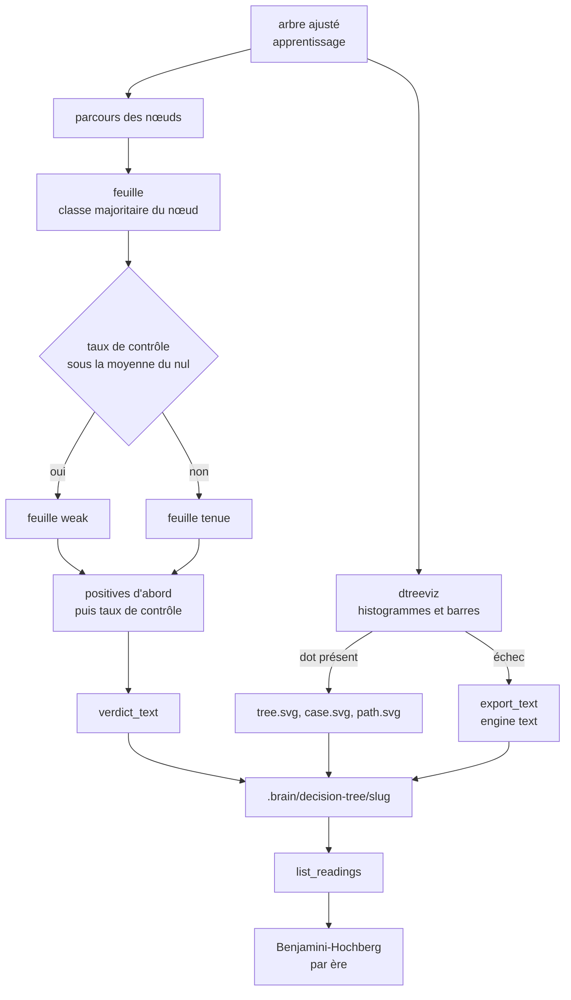
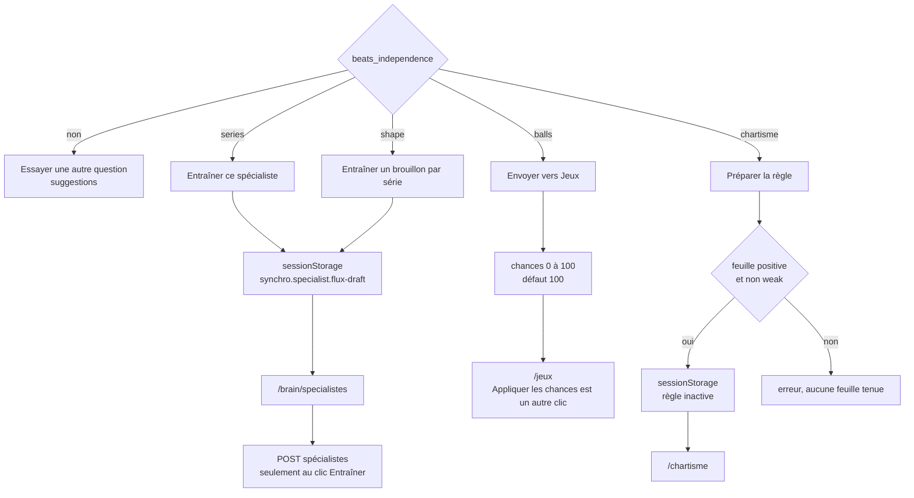

# Sortie — flux

- Module : `/brain/decision-tree`
- Niveau : flux
- Révision : 1
- Code : `synchro/decision_tree/drawing.py`, `rules.py`, `draft.py`, `predict.py`, `store.py`, `jobs.py`, `src/lib/brain/decision-tree-view.ts`

Le rapport est écrit seulement après le dessin. Les SVG restent des fichiers. `report.json` ne les contient pas.

Le dessin du cas reprend le dernier état du flux. `path.svg` ne trace que le chemin de ce cas. Les numéros de nœuds sont posés dans `desc#decision-tree-nodes`, les mêmes que la liste des feuilles. Le seuil affiché a deux décimales, identique au texte de la règle.

`predict_row` marche l’arbre JSON, sans pickle. À gauche si la valeur est inférieure ou égale au seuil, à droite sinon. Les boules notent ainsi `latest_by_ball` : probabilité de la classe sortie, et numéro de feuille.

## Dossier

| Fichier | Contenu |
| --- | --- |
| `config.json` | Question, ère, jour, critère, profondeur, N, date |
| `rules.json` | Chemins |
| `report.json` | Rapport sans les trois SVG |
| `tree.svg` | Arbre, si dtreeviz a réussi |
| `case.svg` | Arbre avec le dernier état |
| `path.svg` | Chemin seul |

Le journal trie par date de fichier, du plus récent au plus ancien. `p_adjusted` et `q_reject` sont calculés à la lecture de la liste, sur toutes les lectures de la même ère, y compris les verdicts sans seuil. L’écran marque une lecture périmée si le nombre de tirages a augmenté, si l’ère a changé, ou si le jour a changé.

## Suite

Une seule action principale. Rien n’est écrit en silence.

Les brouillons de spécialiste n’existent que pour le flux et une série. Ils gardent les feuilles positives tenues au contrôle, sinon les feuilles positives. Une série sans indicateur reconnu n’a pas de brouillon. Les consignes citent la coupe apprise si elle s’écarte de la médiane ou de la parité 3, et les fenêtres qui s’écartent de la période habituelle. n1 bas le dit : le spécialiste binaire apprend la forme haute.

Une règle chartiste reste `active: false`. Elle ne reprend que les feuilles positives tenues. Confiance, activité, figure, courbe, direction hausse et mardi deviennent la condition. L’action est une note, pas une mise.

## Journal

| Révision | Changement |
| --- | --- |
| 1 | Dessin, feuilles, dossier, p corrigé et suite. |
