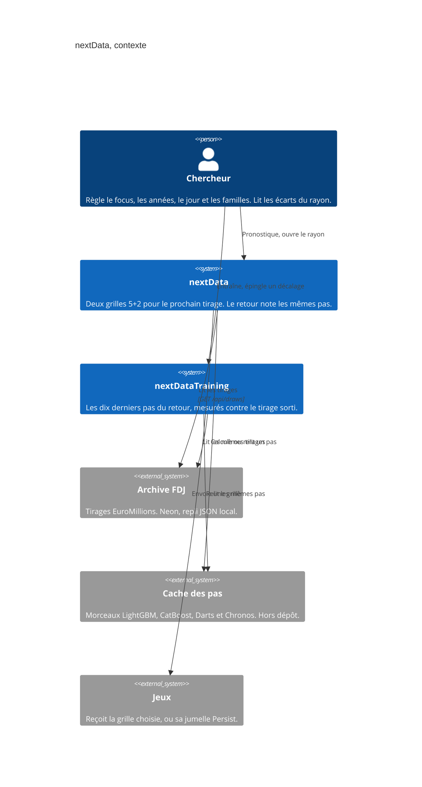
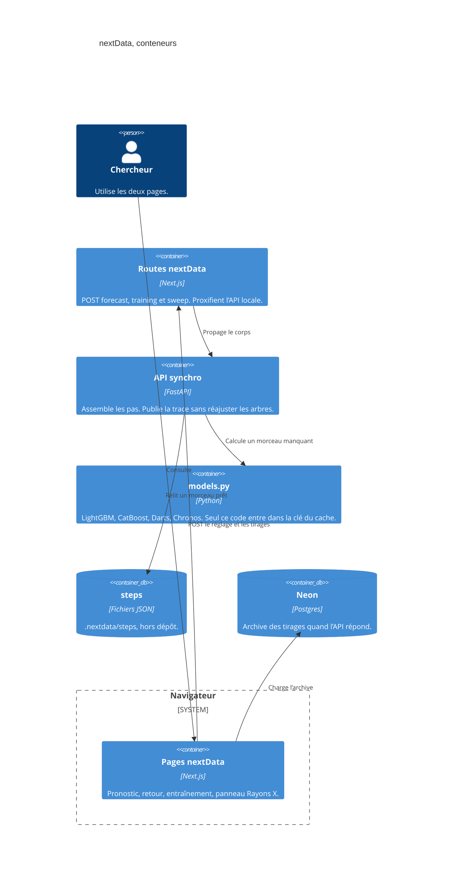

# nextData — contexte

- Module : `/nextdata`
- Niveau : C4 contexte
- Révision : 1
- Code : `src/app/nextdata/page.tsx`, `src/app/nextdatatraining/page.tsx`

Le chercheur parle aux deux pages. Elles partagent l’archive et le cache. Jeux ne reçoit que la grille du pronostic. Le rayon ne parle à personne : il relit la réponse déjà là.

L’assemblage, le calibrage et l’écran vivent hors de `models.py`. Les changer ne recalcule aucun pas. Le rayon dit quelle empreinte d’assemblage a fabriqué la grille affichée.

## Journal

| Révision | Changement |
| --- | --- |
| 1 | Contexte et conteneurs du pronostic, de l’entraînement et du cache des pas. |
