# nextData — traitement

- Module : `/nextdata`
- Niveau : Flux
- Révision : 1
- Code : `synchro/nextdata/xray.py`, `synchro/nextdata/backtest.py`, `synchro/nextdata/project.py`

Une opération a un événement, une règle, un résultat chiffré et un contrôle. Les identifiants ne changent pas.

```mermaid
flowchart LR
  cadre["cadre : archive filtrée"]
  reglage["reglage : familles et bloc"]
  pas["pas : morceaux du cache"]
  matrice["matrice : lignes de perte"]
  quantiles["quantiles : bandes avant Chronos"]
  chronos["chronos : mélange"]
  arbitrage["arbitrage : centres des rangs"]
  projection["projection : grille et faisceau"]
  calibrage["calibrage : bandes déplacées"]
  persist["persist : échanges"]
  controles["controles : écarts en tête"]
  cadre --> reglage
  reglage --> pas
  pas --> matrice
  matrice --> quantiles
  quantiles --> chronos
  chronos --> arbitrage
  arbitrage --> projection
  projection --> calibrage
  calibrage --> persist
  persist --> controles
```

## Règles

`cadre`. Le jour et les années coupent l’archive. Le focus est la queue de ce cadre. Le delta part du tirage d’avant.

`reglage`. Les familles cochées entrent dans LightGBM, CatBoost et Chronos. Un bloc ne retire ses colonnes que si sa famille est cochée.

`pas`. Un pas s’ajuste sur les seuls tirages d’avant. Le cache garde les morceaux. L’assemblage se refait à chaque lecture. L’origine, relu ou calculé, est celle de cette réponse.

`matrice`. Les lags, les lignes de perte et les poids ×3 ou ×1 se déduisent du cadre. Aucun arbre n’est réajusté.

`quantiles`. Bandes 10–90 du modèle, après Darts s’il a remplacé une médiane temporelle, avant le mélange Chronos. L’ordre est lo, puis mid, puis hi.

`chronos`. Il rejoint LightGBM sur la somme, la somme des étoiles et le niveau de n1. CatBoost reste seul. Les poids se règlent sur au plus dix pas d’avant, jamais sur le tirage noté. Sous dix pas, les poids sont moitié-moitié.

`arbitrage`. Le centre mélange le niveau et le delta. La chaîne ne pèse que si ces deux prévisions manquent. Un écart qui sort de sa bande est ramené au bord.

`projection`. La chaîne devient des entiers croissants. La somme, puis l’étendue, rapprochent la grille, un pas à la fois, sur le rang le moins éloigné de son centre. Le faisceau garde le voisin au meilleur score.

`calibrage`. Le bord se déplace du manque de rang 0,9 parmi les pas d’avant. Il en faut neuf. Le tirage noté n’est pas dans ces pas. Sous neuf pas, la bande reste brute.

`persist`. Une boule prévue dans le rayon de n−1 ou n−2 cède sa place, jusqu’à la limite. Une boule déjà dans la grille compte, elle n’est pas reprise une seconde fois.

`controles`. La liste des écarts, dans l’ordre des opérations. Le panneau les met en tête.

## Journal

| Révision | Changement |
| --- | --- |
| 1 | Chaîne des dix opérations et règle de chacune. |
