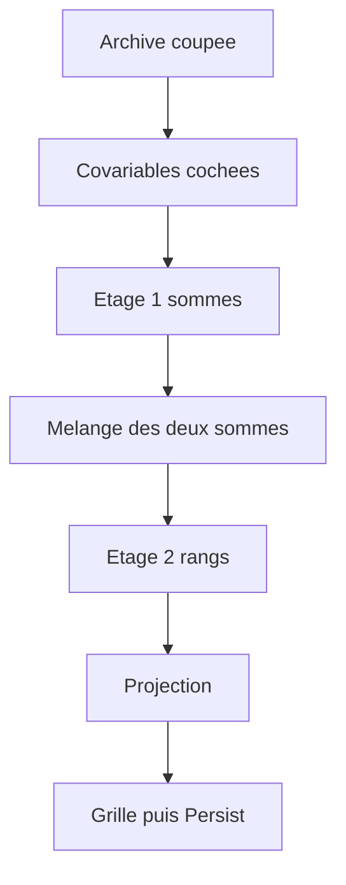

# nextData — flux

- Module : `/nextdata`
- Niveau : Flux
- Révision : 2
- Code : `synchro/nextdata/forecast.py`, `synchro/nextdata/backtest.py`, `synchro/nextdata/models.py`

Les deux flux lisent les mêmes pas, au même réglage, dans le même ordre. Seul l’horizon affiché change.

L’étage 1 ne sort que `sum` et `star_sum`. Chronos n’y met pas `n1`. L’étage 2 ne part que si cette médiane existe. Sa covariable future est cette médiane, jamais le tirage caché.

TimesFM 3.0, bouton éteint par défaut, fait deux appels par mode : les sommes, puis les rangs. Horizon 10, zéro-shot, sans ajuster les poids. Les poids téléchargés sont sous licence non commerciale, hors production. L’usage ici est la recherche locale. Ce n’est pas un ticket.

Le pronostic lit le pas 1. Les dix décalages relisent cet horizon, sans second appel. Le décalage −1 cache le dernier tirage et lit le pas 10. Le décalage −10 lit le pas 1. L’apprentissage s’arrête avant le tirage noté.

Moins de dix pas prêts : TimesFM reste dehors, Chronos reste moitié-moitié avec LightGBM sur les deux sommes. Les rangs ne reçoivent pas de poids.

Méga compare d’autres réglages sur les dix mêmes décalages et lit les deux étages. Le rayon aussi. Il signale une lecture demandée qui n’a rien donné à l’étage 1.

## Journal

| Révision | Changement |
| --- | --- |
| 1 | Flux du prochain tirage et des dix décalages. |
| 2 | Deux étages : sommes, puis rangs. TimesFM en horizon 10, licence non commerciale. |
