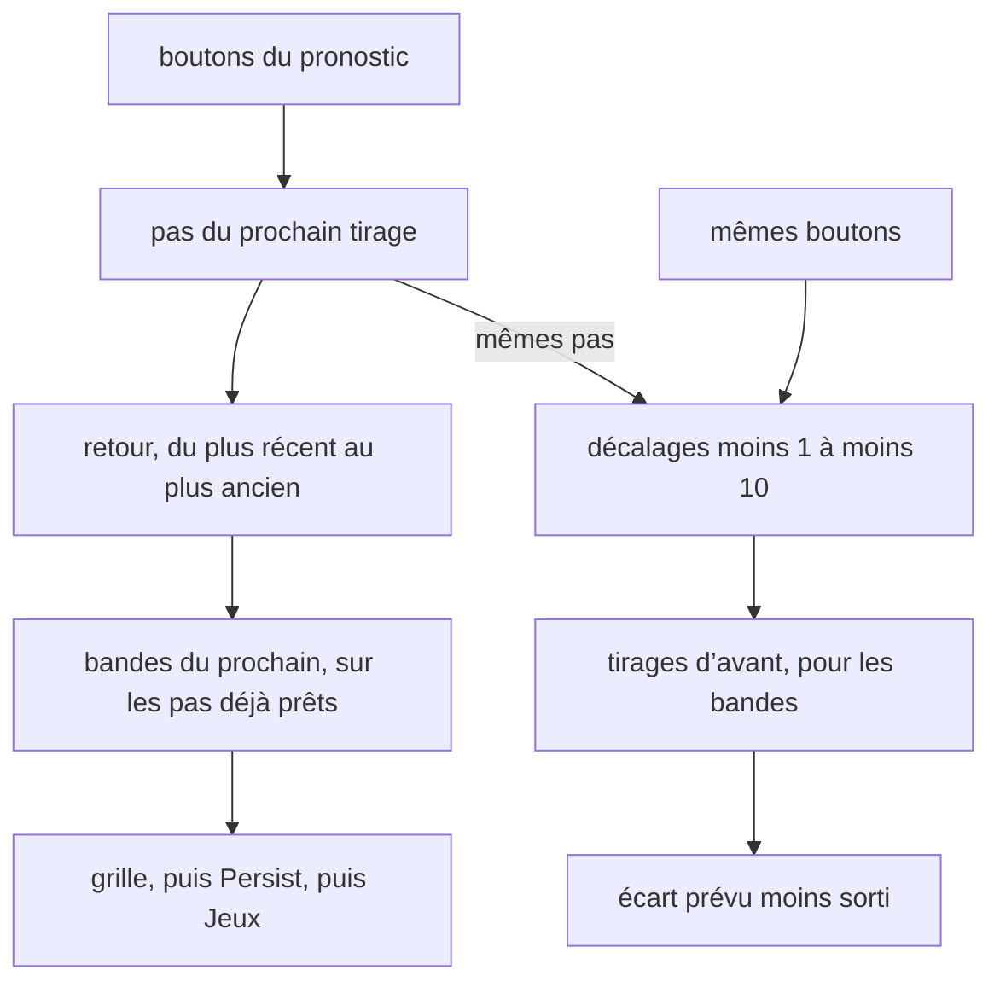

# nextData — flux

- Module : `/nextdata`
- Niveau : Flux
- Révision : 1
- Code : `synchro/nextdata/forecast.py`, `synchro/nextdata/backtest.py`

Les deux flux lisent les mêmes pas, au même réglage. Seul l’horizon change.

Moins 1 cache le dernier tirage et le prévoit. Moins 10 se place dix tirages plus tôt. La fenêtre de Chronos et le calibrage s’arrêtent avant le tirage noté. Tant que les dix pas d’avant manquent, Chronos reste moitié-moitié : la MAE de l’entraînement peut s’écarter de celle du pronostic.

Méga compare d’autres réglages sur les dix mêmes décalages. Le rayon ne les montre pas. Il montre le réglage des boutons.

## Journal

| Révision | Changement |
| --- | --- |
| 1 | Flux du prochain tirage et des dix décalages. |
