# nextData — contrôles

- Module : `/nextdata`
- Niveau : Flux
- Révision : 1
- Code : `synchro/nextdata/xray.py`, `src/components/nextdata/xray-panel.tsx`

Un contrôle en écart remonte en tête du panneau. Les autres restent sur leur carte.

```mermaid
flowchart TB
  cadreFocus["cadre.focus : focus réel plus court que le bouton"]
  cadreAnnees["cadre.annees : année cochée absente du cadre"]
  reglageBloc["reglage.bloc : bloc actif, famille éteinte"]
  pasErreur["pas.erreur : morceau en erreur"]
  pasDarts["pas.darts : Darts hors des médianes temporelles"]
  quantilesOrdre["quantiles.ordre : lo, mid ou hi dans le désordre"]
  chronosFenetre["chronos.fenetre : le tirage noté est dans la fenêtre"]
  chronosMoitie["chronos.moitie : poids moitié-moitié"]
  arbitrageChaine["arbitrage.chaine : repli sur la chaîne"]
  arbitrageBord["arbitrage.bord : écart ramené au bord"]
  projectionGrille["projection.grille : grille invalide"]
  projectionScore["projection.score : pas le meilleur score"]
  calibrageTirage["calibrage.tirage : le tirage noté est dans l’historique"]
  calibrageAnnonce["calibrage.annonce : calibré annoncé, bords vides"]
  persistDoublon["persist.doublon : boule déjà dans la grille"]
  persistLimite["persist.limite : plus d’échanges que la limite"]
  cadreFocus --> cadreAnnees
  cadreAnnees --> reglageBloc
  reglageBloc --> pasErreur
  pasErreur --> pasDarts
  pasDarts --> quantilesOrdre
  quantilesOrdre --> chronosFenetre
  chronosFenetre --> chronosMoitie
  chronosMoitie --> arbitrageChaine
  arbitrageChaine --> arbitrageBord
  arbitrageBord --> projectionGrille
  projectionGrille --> projectionScore
  projectionScore --> calibrageTirage
  calibrageTirage --> calibrageAnnonce
  calibrageAnnonce --> persistDoublon
  persistDoublon --> persistLimite
```

Darts peut remplacer la médiane temporelle. La chaîne des écarts reste LightGBM : si une clé de rang bouge, `pas.darts` est un écart.

`chronos.moitie` n’est pas une panne. Il dit que les dix pas d’avant ne sont pas prêts, et que la MAE peut encore bouger.

`arbitrage.bord` nomme l’écart collé au bord. Ce bord décale les rangs qui suivent.

## Journal

| Révision | Changement |
| --- | --- |
| 1 | Liste des contrôles, dans l’ordre du panneau. |
