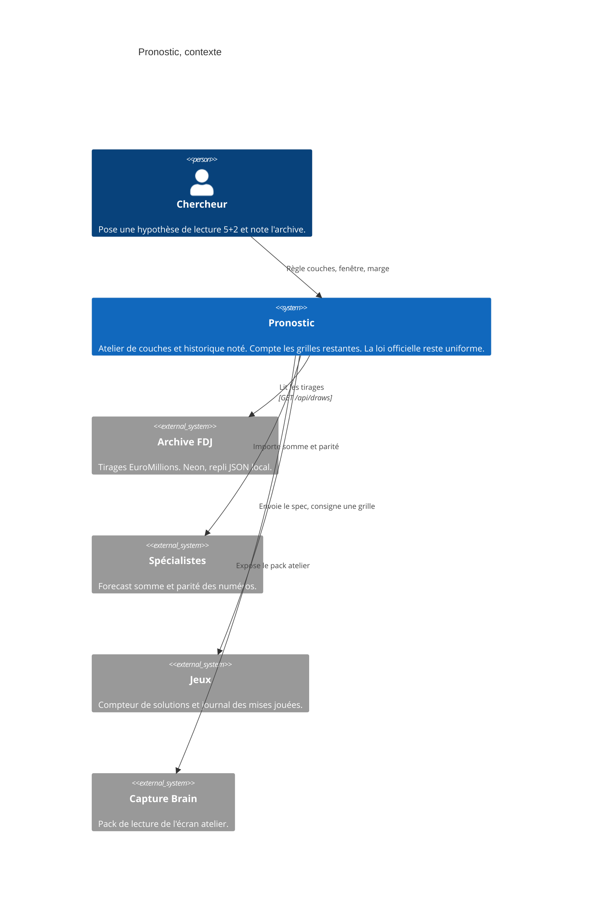

# Pronostic — contexte

- Module : `/pronostic`
- Niveau : C4 contexte
- Révision : 1
- Code : `src/app/pronostic/page.tsx`, `src/components/pronostic/pronostic-lab.tsx`

Le chercheur ne parle qu’à Pronostic. L’archive alimente les deux onglets. Les spécialistes et Jeux ne touchent que l’atelier. La capture lit l’atelier, pas le comité.

## Journal

| Révision | Changement |
| --- | --- |
| 1 | Contexte aligné sur la page, l’archive, les spécialistes, Jeux et la capture. |
