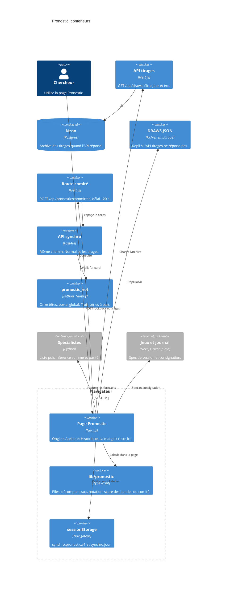

# Pronostic — conteneurs

- Module : `/pronostic`
- Niveau : C4 conteneurs
- Révision : 1
- Code : `src/lib/use-draws.ts`, `src/app/api/pronostic/committee/route.ts`, `synchro/app.py`, `synchro/pronostic_net/`

`k` ne part pas vers Python. Le comité renvoie des centres et des écarts. Le navigateur applique la marge et compte les grilles.

## Journal

| Révision | Changement |
| --- | --- |
| 1 | Conteneurs du navigateur, du proxy et de pronostic_net. |
