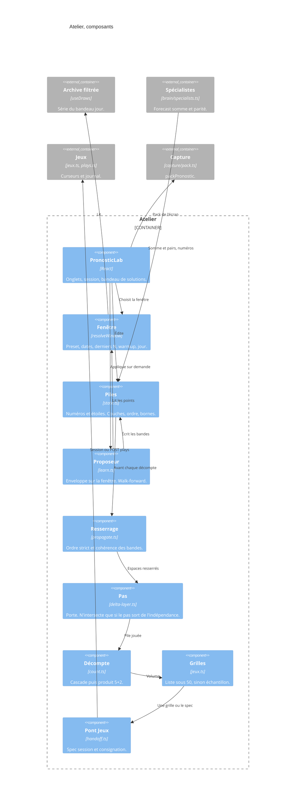

# Atelier — composants

- Module : `/pronostic` onglet Atelier
- Niveau : C4 composants
- Révision : 1
- Code : `src/components/pronostic/pronostic-lab.tsx`, `src/lib/pronostic/`

Le proposeur affiche une proposition. Le décompte ne la voit qu’après **Appliquer**. Le pas éteint laisse le décompte des trois couches de niveau.

## Journal

| Révision | Changement |
| --- | --- |
| 1 | Composants de l’atelier et de leurs fichiers. |
