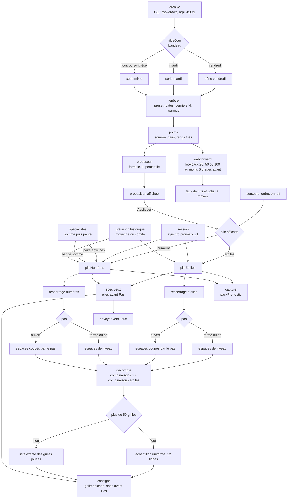
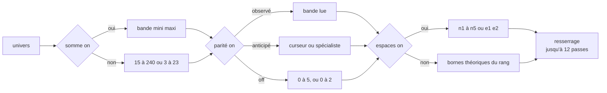

# Atelier — flux

- Module : `/pronostic` onglet Atelier
- Niveau : flux
- Révision : 1
- Code : `src/components/pronostic/pronostic-lab.tsx`, `src/lib/pronostic/learn.ts`, `propagate.ts`, `delta-layer.ts`, `count.ts`

Deux piles vivent en parallèle, numéros (1–50, cinq rangs, somme 15–240) et étoiles (1–12, deux rangs, somme 3–23). L’écran n’en montre qu’une. Le produit final multiplie les deux décomptes. La liste et l’échantillon suivent les piles après Pas. Le spec envoyé à Jeux, et celui qui accompagne une consignation, part des piles avant Pas : le pont ne fait que le resserrage.

## Couches d’une pile

L’ordre des couches est celui de l’écran. Une couche éteinte sort du décompte et reprend ses bornes théoriques. **Haut** et **Bas** ne changent que l’ordre de la cascade affichée.

Le resserrage impose un ordre strict (n1 avant n2, un numéro pris une seule fois). Il recoupe la somme réalisable, la parité réalisable, et retire de chaque espace les valeurs incompatibles. Une bande vide arrête le décompte à 0 et affiche le diagnostic.

## Porte Pas

Pas est éteint par défaut. Allumé, il ne change le décompte que si la fenêtre a au moins 8 points et que le pas s’écarte de deux tirages indépendants : mélange des mêmes niveaux, ou loi de la valeur absolue du delta. Sinon la porte reste fermée et les curseurs d’espaces ne bougent pas.

Trois lectures de rang : fermé, persiste, repousse. Trois lectures de bord : fermé, glisse, se sépare.

## Proposeur

| Formule | Bande, avant bornes théoriques |
| --- | --- |
| min/max ± k·σ | minimum observé moins k·σ, maximum observé plus k·σ |
| moyenne ± k·σ | moyenne moins k·σ, moyenne plus k·σ |
| percentiles | queue basse P, queue haute 100 moins P |

Les bornes passent par un plancher et un plafond entiers, puis par les bornes théoriques de l’axe. Le walk-forward refait cette enveloppe sur les seuls tirages d’avant chaque point de la fenêtre. Il affiche le taux de hits et le volume moyen restant. Il n’écrit pas dans les piles.

## Journal

| Révision | Changement |
| --- | --- |
| 1 | Flux de l’atelier, couches, pas et proposeur. |
