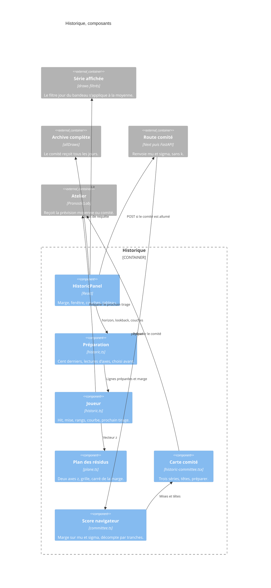

# Historique — composants

- Module : `/pronostic?tab=historic`
- Niveau : C4 composants
- Révision : 1
- Code : `src/components/pronostic/historic-panel.tsx`, `historic-committee.tsx`, `historic-plane.tsx`, `src/lib/pronostic/historic.ts`, `committee.ts`, `plane.ts`

La préparation et le joueur tournent dans la page, par tranches, pour laisser l’écran répondre. Le comité distant ne compte pas les grilles : il ne renvoie que des moments.

## Journal

| Révision | Changement |
| --- | --- |
| 1 | Composants de la notation, du plan et du score du comité. |
