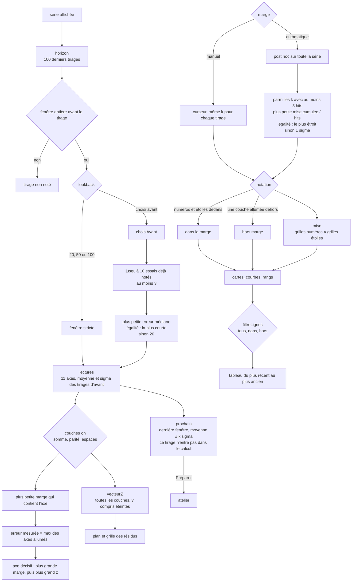

# Historique — flux

- Module : `/pronostic?tab=historic`
- Niveau : flux
- Révision : 1
- Code : `src/lib/pronostic/historic.ts`, `src/components/pronostic/historic-panel.tsx`

La série notée est déjà passée par `filtreJour`. Le comité, lui, repart de l’archive non filtrée. Voir [Comité](07-comite-flux.md).

## Axes

Onze axes, dans cet ordre : somme, pairs, n1, n2, n3, n4, n5, somme étoiles, pairs étoiles, e1, e2.

Pour chaque axe, sur les tirages strictement antérieurs :

- moyenne arithmétique
- écart-type d’échantillon, diviseur n − 1
- z = (réel − moyenne) / σ quand σ est positif
- si σ vaut 0 et que le réel diffère, z est vide et aucune marge finie ne couvre l’axe
- bande entière : plancher en bas, plafond en haut, recoupée par les bornes théoriques
- à 0 σ, la moyenne entière tient une seule valeur ; sinon la bande tient les deux entiers qui l’encadrent

Pas de marge : 0, 0,25, 0,5, 0,75, 1, 1,25, 1,5, 1,75, 2, 2,5, 3. Défaut manuel : 1. Au-delà de 3, l’erreur mesurée est vide et la courbe la place à part.

Une couche éteinte ne fait pas sortir le tirage et ne réduit pas la mise. Elle reste dans le vecteur z.

## Pas dans l’historique

Pas allumé resserre la mise comme dans l’atelier. Il ne change ni l’erreur mesurée, ni l’axe décisif, ni le vecteur z. Le rapport Pas compte les fenêtres où la porte s’ouvre, les tirages que le niveau contenait et que le pas exclut, et les grilles économisées.

## Partie jouée

À côté du choix automatique post hoc, la partie jouée refait le même ratio avant chaque tirage, uniquement sur les tirages déjà notés. C’est elle qui fige une marge annoncée. Elle est affichée avec le comité. Sans comité, la carte moyenne la calcule aussi en mode automatique.

## Rangs et courbes

Le tableau **Paramètres qui pèsent** ne classe que les axes allumés : fois décisif, puis hors marge, puis |z| médian.

La courbe du haut est l’erreur mesurée de chaque tirage. La ligne horizontale est la marge en cours. La courbe du bas est la part des tirages déjà notés dont l’erreur tient dans chaque pas. Elle ne refait pas le décompte. La mise se recalcule à la marge choisie.

## Plan

Le plan place chaque tirage noté sur deux axes du vecteur z. La paire par défaut suit l’ordre du tableau des rangs. Le carré dessine ±k·σ de la marge en cours. La grille reprend le même vecteur, une ligne par tirage et une colonne par axe allumé.

## Journal

| Révision | Changement |
| --- | --- |
| 1 | Flux de notation, marge, choisi avant, mise et plan. |
