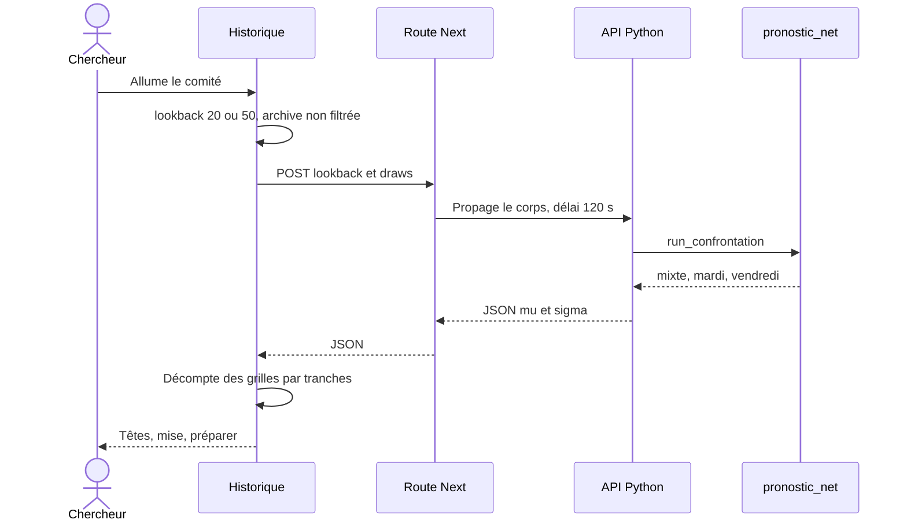
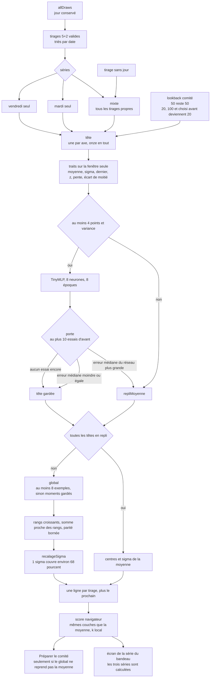

# Comité — flux

- Module : historique, calcul optionnel
- Niveau : flux
- Révision : 1
- Code : `src/lib/pronostic/committee.ts`, `src/app/api/pronostic/committee/route.ts`, `synchro/pronostic_net/committee.py`, `workers.py`

Le comité est éteint par défaut. Allumé, il confronte ses bandes à la moyenne de fenêtre. La marge k reste dans le navigateur.

Sans API locale, ou après trois essais espacés de 1 s, 2 s et 4 s sur une 503, la page dit que Python est absent. La marge et la mise restent celles de la moyenne. Un délai dépassé laisse une erreur, sans comité. Pendant le calcul, le curseur de marge reste affiché et désactivé.

## Têtes

Chaque tête ne s’ajuste que sur la fenêtre (`lookback` situations d’avant), pas sur toute l’archive. Les traits d’une tête sont calculés sur cette fenêtre, axe par axe.

La porte compare, sur au plus dix ajustements antérieurs de la même tête, la médiane des erreurs absolues du réseau à celle de la moyenne. Si le réseau est pire, la tête reprend la moyenne. À égalité, le réseau reste. Sans ajustement antérieur, le réseau reste aussi, dès qu’il a pu être appris.

Le tableau **Têtes** montre la décision, μ, σ, et le nombre de fois où la tête a été gardée.

## Global

Le global ne réécrit les centres que si au moins une tête reste en réseau. Son entrée est la concaténation des moments gardés et des moments de la moyenne. Il apprend un réseau gaussien multi-sorties sur au plus `lookback` exemples d’avant, seuil de 8 exemples. Ensuite :

- les rangs redeviennent croissants dans leurs bornes emboîtées
- la somme est ramenée près de la somme des rangs, dans 15–240 ou 3–23
- la parité est recoupée à 0–5 ou 0–2
- σ affiché est σ brut multiplié par un facteur, pour que μ ± 1 σ couvre le quantile 68,27 % des |z| d’avant
- moins de cinq écarts, ou un quantile quasi nul : le facteur vaut 1

Si toutes les têtes sont en repli, le global n’écrit rien. **Préparer le comité** ne propose alors pas une autre prévision que la moyenne.

## Trois séries

Mixte, mardi et vendredi ne partagent aucun poids. Un tirage sans jour n’entre que dans le mixte. Les trois tournent en parallèle dès que l’archive dépasse 160 tirages et que deux séries sont assez longues. Le filtre du bandeau choisit seulement la série affichée. L’affichage synthèse ou tous montre le mixte.

En mode automatique, quand le comité a répondu, la marge affichée est celle du post hoc de la série affichée. La partie jouée du comité fige cette marge tirage par tirage.

## Journal

| Révision | Changement |
| --- | --- |
| 1 | Flux du comité, porte, global et trois séries. |
