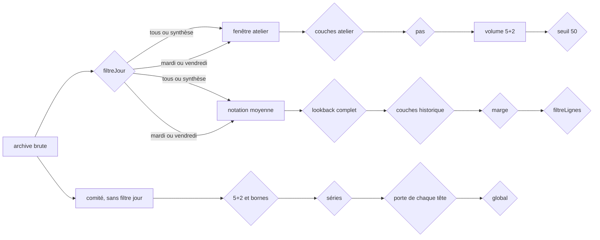

# Filtres

- Module : atelier et historique
- Niveau : flux
- Révision : 1
- Code : `src/lib/weekday-scope.ts`, `src/lib/analysis-window.ts`, `src/lib/pronostic/state.ts`, `historic.ts`, `committee.ts`, `synchro/pronostic_net/committee.py`

Un filtre coupe un flux. Le schéma dit l’entrée, la condition, et ce qui continue.

## Inventaire

| Identifiant | Entrée | Condition pour passer | Sortie | Qui l’applique |
| --- | --- | --- | --- | --- |
| `filtreJour` | Archive | tous et synthèse gardent le mixte ; mardi ou vendredi ne gardent que ce jour | Série de l’atelier et de la moyenne | Bandeau, avant les deux onglets |
| `fenetre` | Série filtrée | Preset, dates, derniers N, warmup | Points de travail | Atelier seul |
| `pool` | Deux piles | Affiche numéros ou étoiles | Une pile à l’écran | Atelier. Le produit compte toujours les deux |
| `couches` | Pile | Couche on | Somme, parité ou espaces dans le décompte | Atelier et historique. Off = bornes théoriques |
| `pariteMode` | Couche parité | Observé lit la fenêtre ; anticipé lit le curseur | Bande de pairs | Atelier |
| `resserrage` | Bandes | Ordre strict possible, somme et parité compatibles | Bandes recoupées, ou volume 0 | Atelier, avant le décompte |
| `pas` | Espaces resserrés | Porte ouverte : au moins 8 points et pas hors indépendance | Espaces plus étroits | Atelier et mise historique. Hors de l’erreur mesurée |
| `seuilListe` | Volume 5+2 | 1 à 50 grilles | Liste exacte. Au-delà, échantillon de 12 | Atelier |
| `horizon` | Série filtrée | Les 100 plus récents | Tirages candidats à la note | Historique |
| `lookback` | Candidat | 20, 50 ou 100 tirages entiers avant lui | Tirage noté. Fenêtre incomplète ignorée | Historique. L’archive 2026 laisse 100 vide |
| `choisiAvant` | Trois lookbacks | Au moins 3 essais parmi les 10 d’avant | Fenêtre de plus petite erreur médiane, sinon la plus courte, sinon 20 | Historique, mode choisi avant |
| `marge` | Axes allumés | Bande moyenne ± k·σ contient la valeur | Hit d’axe | Historique. Pas discrets jusqu’à 3 |
| `notation` | Hits d’axes | Numéros et étoiles contenus | Tirage dans la marge | Historique |
| `automatique` | Lignes notées | Au moins 3 hits | k de plus petit ratio mise / hits | Historique. Sinon 1 σ |
| `partieJouee` | Préfixe des lignes | Même règle, tirages d’avant seulement | k figé avant le tirage | Historique, à côté du post hoc |
| `filtreLignes` | Lignes notées | tous, dans la marge, hors marge | Tableau | Affichage seul |
| `planAxes` | Vecteur z | Deux axes choisis, défaut = ordre des rangs | Nuage et carré ±k·σ | Plan |
| `lookbackComite` | Choix historique | 50 reste 50 | 20 ou 50 envoyés à Python | 100 et choisi avant deviennent 20 |
| `tiragePropre` | Corps POST | 5 numéros distincts dans 1–50, 2 étoiles distinctes dans 1–12 | Tirage du comité | Python. Le reste est écarté |
| `series` | Tirages propres | Jour mardi, vendredi, ou aucun | Trois calculs séparés. Sans jour = mixte seul | Comité. Pas de mercredi |
| `assezTete` | Fenêtre d’un axe | Au moins 4 points et variance | Réseau de la tête | Sinon moyenne |
| `porte` | Erreurs d’avant | Médiane réseau inférieure ou égale à la moyenne, sur au plus 10 essais | Tête gardée | Sinon moyenne. Égalité : le réseau reste |
| `global` | Onze décisions | Au moins une tête gardée, et 8 exemples | Centres réécrits | Sinon moyenne, bouton Préparer inactif |
| `projection` | Centres du global | Rangs croissants, somme et parité dans leurs bornes | μ jouable | Comité |
| `recalageSigma` | \|z\| d’avant | Au moins 5 écarts et quantile non nul | σ × quantile 68,27 % | Sinon σ inchangé |
| `scopeEcran` | Trois séries scorées | Bandeau mardi, vendredi, ou le reste | Série affichée | Les trois sont calculées quand même |

Le filtre jour ne s’applique pas au corps du comité. Le comité recalcule les trois séries même quand l’écran n’en montre qu’une.

## Journal

| Révision | Changement |
| --- | --- |
| 1 | Inventaire des filtres de l’atelier, de la notation et du comité. |
